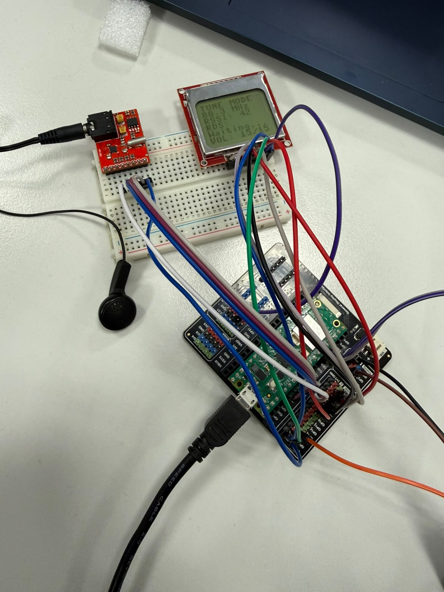

# Micropico FM Receiver with Digital Tuning

**Digital Electronics 2 Final Project**
*Raspberry Pi Pico MicroPython Implementation*

[](https://robikhx.github.io/MicroPython_FMReceiver_2026/)

## 1. Problem Statement & Solution Summary

### Problem Statement

Standard analog FM receivers lack precise digital frequency control, visual feedback, signal quality metrics, and preset station management. Furthermore, building compact embedded digital receivers requires tight timing coordination between real-time input devices (rotary encoders), I2C tuner ICs, and SPI visual displays without audio output degradation or UI lag.

### Solution

This project implements a fully digital FM radio receiver using the **Raspberry Pi Pico (RP2040)** running MicroPython. The system features:

* **Digital Tuning & RDS:** Real-time frequency control via an I2C-controlled **Si4703 FM tuner module**, capable of reading Signal Strength (RSSI) and RDS station text.
* **User Interface:** A low-power **Nokia 5110 LCD screen** (PCD8544 controller via SPI) displaying tuning frequency, RSSI bar
* **Input Control:** A **KY-040 Rotary Encoder** utilizing hardware interrupts for smooth frequency stepping and button-activated preset switching.
* **Isolated Audio:** Audio output is tapped directly from the Si4703 3.5mm jack into headphones or an external powered amplifier.

---

## 2. Team Members & Contributions

* **Robert Tarnita Gabriel**
  * **Role:** Lead Software Engineer & Source Control
  * **Responsibilities:** MicroPython driver integration (`Si4703`, `Nokia5110`, `RotaryEncoder`), interrupt-driven concurrency setup, software architecture, repository structure and management
* **Daniel Marchis Lucian**
  * **Role:** Hardware & Physical Assembly Engineer
  * **Responsibilities:** Component research, schematic design, wiring layout, power and physical breadboard assembly.
* **Danut Comsa Valentin**
  * **Role:** Test Engineer & Documentation Lead
  * **Responsibilities:** System parameter measurements (update rates, RSSI range, response latency), project poster design, verification testing, and video production.

---

## 3. Project Structure

Below is the repository structure required for code execution, documentation generation, and submission assets:

```text
micropico-fm-receiver/
├── docs/
│   ├── conf.py
│   ├── requirements.txt
├── images/
│   ├── block_diagram.png
│   ├── wiring_schematic.png
│   ├── poster.png
│   └── prototype_photo.jpeg
├── src/
│   ├── main.py
│   ├── nokia5110.py
│   ├── rotary_encoder.py
│   ├── si4703.py
│   └── config.py
├── tests/
│   ├── test_display.py
│   ├── test_encoder.py
│   └── test_tuner.py
├── README.md
├── LICENSE
└── .gitignore
```

---

## 4. Hardware Inventory & Assumptions

### Bill of Materials


| Quantity | Component Description                 | Interface / Specs               | Notes                                    |
| :------- | :------------------------------------ | :------------------------------ | :--------------------------------------- |
| 1x       | Raspberry Pi Pico                     | RP2040 Dual-Core ARM Cortex-M0+ | 3.3V Logic Level                         |
| 1x       | Si4703 FM Tuner Module               | I2C + 3.5mm Jack                | Includes headphone amp / antenna         |
| 1x       | Nokia 5110 Display (PCD8544)          | SPI (84x48 Graphic LCD)         | Backlit graphical LCD                    |
| 1x       | HW-322 / KY-040 Rotary Encoder Module | Quadrature + Push Button        | Includes pull-up resistors               |
| 1x       | 3.5mm Headphones                      | Analog Audio                    | **Audio source** (Cable acts as antenna) |
| 1x       | Breadboard & Jumper Wires             | N/A                             | Circuit interconnections                 |

### Key Assumptions & Limitations

1. **Audio Path:** The Pico **never** drives speaker loads directly via GPIO. Audio signals originate exclusively from the Si4703 3.5mm output jack.
2. **Antenna Requirement:** The Si4703 uses connected headphones or a 3.5mm auxiliary cable as speaker.
3. **Operating Voltage:** All modules run on the Pico’s 3.3V rail (`3V3_OUT`).

---

## 5. Wiring Diagram & Pinout Connection

### Hardware Pin Mapping Table


| Component          | Component Pin | Pico Pin Name   | Pico Physical Pin | Function / Supply Details        |
| :----------------- | :------------ | :-------------- | :---------------- | :------------------------------- |
| **Si4703 Tuner**   | VCC           | 3V3_OUT         | Pin 36            | Power (3.3V, max 50mA)           |
|                    | GND           | GND             | Pin 38            | Common Ground                    |
|                    | SDIO (SDA)    | GP4 (I2C0 SDA)  | Pin 6             | I2C Data (pull-up configured)    |
|                    | SCLK (SCL)    | GP5 (I2C0 SCL)  | Pin 7             | I2C Clock                        |
|                    | RST           | GP6             | Pin 9             | Tuner Reset Pin                  |
| **Nokia 5110 LCD** | VCC           | 3V3_OUT         | Pin 36            | Power (3.3V)                     |
|                    | GND           | GND             | Pin 38            | Common Ground                    |
|                    | CLK           | GP18 (SPI0 SCK) | Pin 24            | SPI Serial Clock                 |
|                    | DIN (MOSI)    | GP19 (SPI0 TX)  | Pin 25            | SPI Data Input                   |
|                    | DC            | GP20            | Pin 26            | Data / Command Control           |
|                    | CE (CS)       | GP17 (SPI0 CSN) | Pin 22            | Chip Enable                      |
|                    | RST           | GP21            | Pin 27            | Display Reset                    |
|                    | LIGHT         | 3V3_OUT / GP22  | Pin 36 / 28       | Backlight supply                 |
| **KY-040 Encoder** | +             | 3V3_OUT         | Pin 36            | Power (3.3V)                     |
|                    | GND           | GND             | Pin 38            | Common Ground                    |
|                    | CLK           | GP14            | Pin 19            | Rotary Channel A (Interrupt IRQ) |
|                    | DT            | GP15            | Pin 20            | Rotary Channel B                 |
|                    | SW            | GP16            | Pin 21            | Push Button (Interrupt IRQ)      |

## 6. Software Architecture & Classes

The codebase is organized into modular classes to enforce encapsulation and code reusability:

1. **`Si4703` (`src/si4703.py`):**
   * Encapsulates I2C communications with the Silicon Labs Si4703 chip.
   * Handles initialization sequence, hardware reset, channel frequency calculation ($MHz \leftrightarrow \text{Channel ID}$), volume adjustment, RSSI register polling, and RDS block decoding.
2. **`Nokia5110` (`src/nokia5110.py`):**
   * Encapsulates SPI communication with the PCD8544 display controller.
   * Manages an 84x48 frame buffer, custom typography rendering, RSSI signal bar drawing routines, and partial screen updates.
3. **`RotaryEncoder` (`src/rotary_encoder.py`):**
   * Provides non-blocking quadrature decoding via MicroPython `Pin.IRQ_RISING` / `Pin.IRQ_FALLING` interrupts.
   * Implements software debouncing for reliable step detection and switch press handling.
4. **`main.py` (`src/main.py`):**
   * Instantiates hardware classes, manages state (current frequency, volume, station presets), and runs the asynchronous event execution loop.

### Component Class Justification

Each integrated component (Si4703, PCD8544, KY-040) retains complex internal state (e.g., register configurations, display buffers, interrupt pin states). Implementing them as reusable classes allows isolated unit testing and simple porting across RP2040 platforms.

---

## 7. Timing & Concurrency Plan

To maintain smooth audio processing, responsive UI updates, and zero missed encoder steps, task timing is partitioned into periodic interrupt and loop activities:


| Activity              | Execution Mechanism   | Interval / Rate            | Priority | Goal                                               |
| :-------------------- | :-------------------- | :------------------------- | :------- | :------------------------------------------------- |
| **Encoder Decoding**  | Hardware Pin IRQ      | Immediate (Edge triggered) | High     | Zero missed step increments during fast rotation   |
| **Button Debounce**   | Timer / IRQ Timestamp | 50 ms debounce window      | High     | Prevent double-triggering on preset toggle         |
| **Display Refresh**   | Periodic Loop Routine | ~50 ms (20 Hz)             | Medium   | Flicker-free visual feedback of frequency changes  |
| **RSSI & RDS Read**   | Periodic Polling      | ~300 ms                    | Low      | Read signal strength and station text over I2C     |
| **Preset Flash Save** | Asynchronous Event    | On long-press switch event | Low      | Store user presets to flash without blocking audio |

---

## 8. Setup & Operating Instructions

### Prerequisites & Dependencies

* **MicroPython Firmware:** v1.20 or later flashed to Raspberry Pi Pico.
* **Development Environment:** Thonny IDE, VS Code with MicroPico extension, or `rshell`.

### Installation

1. Flash the latest MicroPython `.uf2` image onto the Raspberry Pi Pico.
2. Clone this repository:
   ```bash
   git clone https://github.com/Robikhx/MicroPython_FMReceiver_2026
   cd micropico-fm-receiver
   ```
3. Upload all source files from `src/` to the Pico's root directory:
   ```bash
   ampy --port COM3 put src/nokia5110.py
   ampy --port COM3 put src/si4703.py
   ampy --port COM3 put src/rotary_encoder.py
   ampy --port COM3 put src/config.py
   ampy --port COM3 put src/main.py
   ```

### Operating Instructions

1. **Power On:** Connect 3.5mm headphones or an aux cable connected to an amplifier into the Si4703 3.5mm jack. Power the Pico via USB.
2. **Frequency Tuning:** Rotate the encoder knob clockwise to tune up (+0.1 MHz) or counter-clockwise to tune down (-0.1 MHz).
3. **Preset Switching:** Short-press the rotary encoder shaft button to cycle through saved station presets.
4. **Save Preset:** Press and hold the rotary encoder shaft button for > 2 seconds on any active frequency to save it to the current preset slot.
5. **Display Metrics:** Observe real-time frequency ($MHz$), signal strength ($dBuV$), and RDS station text on the LCD.

---

## 9. Evidence of Testing

### Prototype Screenshots


Figure 1: Fully assembled breadboard prototype with active Nokia 5110 UI display, Si4703 audio output and KY-040 Encoder .

## 10. Deliverables & Presentation Links

* **Demonstration Video:** [Watch Project Demo Video on YouTube](https://youtube.com/watch?v=placeholder)
* **Project Poster:** [View Project Poster](docs/poster.pdf).

---

## 11. License

* **License:** Open-source under the [MIT License](LICENSE).
